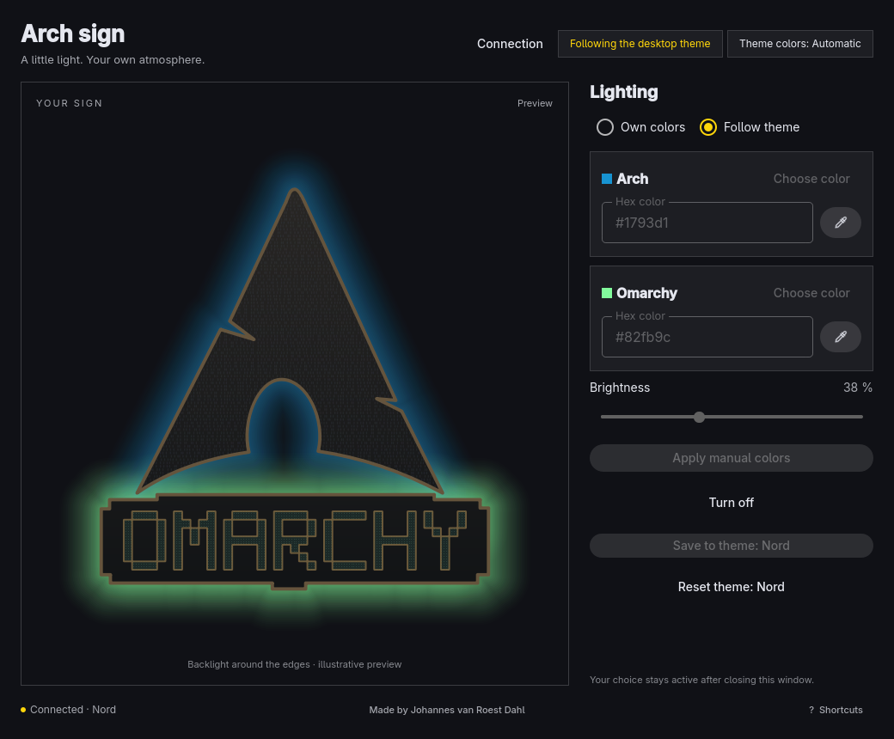

# Arch Sign



Control a backlit Arch/Omarchy sign from your Omarchy desktop. Follow the active
theme, choose separate colors for the two logos, pick a color from the screen,
and save your favorite colors and brightness per theme.

## Install on Arch Linux / Omarchy

Install the `arch-sign-0.2.0-1-x86_64.pkg.tar.zst` package from the release:

```sh
sudo pacman -U ./arch-sign-0.2.0-1-x86_64.pkg.tar.zst
```

Pacman installs the runtime dependencies. The package includes the desktop app,
Python sync script, systemd user service, configuration template and optional
Omarchy bar shortcut. Open **Arch Sign** from `Super+Space`, enter the ESP32's
address (for example `http://192.168.1.120`), and click **Save and connect**.
The background service starts now and automatically at future logins.

To build from a source checkout or release source archive:

```sh
./install.sh
```

This installs Arch's build tools, builds and installs the package, and migrates
an existing `host/config.json` if present. Then open the app to complete setup.
Run the installer as your normal user; it requests sudo only for package changes.
The initial prebuilt package targets x86_64. Other platforms are not validated.

## Using the app

- **Follow theme** uses the theme's folder icon color for Arch and accent color
  for Omarchy, unless you saved a custom palette for that theme.
- **Own colors** enables separate logo color pickers, hex fields and desktop
  pipettes. Click **Apply manual colors** to send them to the sign.
- **Save to theme: …** stores both colors and brightness for the active theme.
- **Reset theme: …** removes only that theme's saved palette and returns to
  automatic theme colors.
- **Turn off** keeps the sign dark until you select a lighting mode again.
- **Connection** changes the ESP32 address and optionally adds an icon beside
  the Omarchy clock. The app follows Omarchy's full palette and language live.

The GUI can be closed while the background service keeps working. The host
resends every 10 seconds. The firmware turns the LEDs off after 15 seconds
without updates, including when the computer shuts down or sleeps. Startup is
blue for Arch and green for Omarchy; without Wi-Fi Arch blinks until that timeout.

## Hardware and firmware

This release's desktop package works with the ESP32-C3 firmware in this repo.
ESP32 firmware setup is still a separate hardware step: Wi-Fi credentials, LED
pin, LED count, wiring and segment ranges depend on your sign. Release assets
never contain firmware built with private Wi-Fi credentials.

1. Copy `include/secrets.example.h` to `include/secrets.h`.
2. Set your Wi-Fi name/password, data pin, LED count and brightness.
3. Install PlatformIO and build/upload:

   ```sh
   pio run
   pio run -t upload
   pio device monitor
   ```

PlatformIO detects the serial port; pass `--upload-port /dev/ttyACM0` if needed.
The ESP32 prints its IP address after connecting to Wi-Fi.

Connect the strip's `DIN` to `LED_PIN`, and share ground with the ESP32 and 5V
strip supply. The example configuration has 110 LEDs, with inclusive ranges:

| Zone | LED indices |
|---|---|
| Arch | 0–22, 39, 73–109 |
| Omarchy | 23–38, 40–72 |

For a different layout, edit `led_segments` in your user config and the startup
ranges in `isArchLed()` in `src/main.cpp`. Use a suitable external power supply
and power injection for the strip; a data level shifter may be needed.
The provided secrets file is a template, not preconfigured hardware settings.

## Configuration, migration and troubleshooting

- Device and segment settings: `~/.config/arch-sign/config.json`.
- Manual choices and saved theme palettes: `~/.local/state/arch-sign/control.json`.
- Last delivery result: `~/.local/state/arch-sign/status.json`.
- Existing saved palettes survive upgrades. Setup backs up an existing device
  config and legacy user service before changing them.

To migrate a checkout-based installation manually, preserving LED segments:

```sh
arch-sign-setup --url http://YOUR_ESP32_IP --migrate-config /path/to/old/host/config.json
```

If a new user config already exists, setup preserves it rather than importing
the old one again. Change the address in the app's **Connection** dialog.
Advanced config edits require restarting the service.

```sh
systemctl --user status arch-omarchy-sign.service
systemctl --user restart arch-omarchy-sign.service
journalctl --user -u arch-omarchy-sign.service -n 30
arch-sign status --json
```

If the service is stopped or the sign is unreachable, the app shows a connection
error. The setup dialog saves the address and starts the service; delivery is
confirmed separately by the app's connection status.

The optional bar shortcut requires the newer Omarchy shell. No theme files are
modified. Saved palettes and other user settings are not removed by uninstall.
Remove the optional bar icon with `omarchy plugin disable local.arch-sign`, then
stop the service and uninstall with `sudo pacman -Rns arch-sign`.

## Development and release

```sh
desktop/bin/build
desktop/bin/test
python3 -m unittest discover -s host -p 'test_*.py'
g++ -std=c++11 -Iinclude tests/timing_test.cpp -o /tmp/sign-timing-test
/tmp/sign-timing-test
```

See [desktop documentation](desktop/README.md), [release notes](CHANGELOG.md)
and [release process](RELEASING.md). GitHub Actions builds and tests an Arch
package from a clean container. Built firmware containing your credentials and
local configuration must never be attached to a release.
