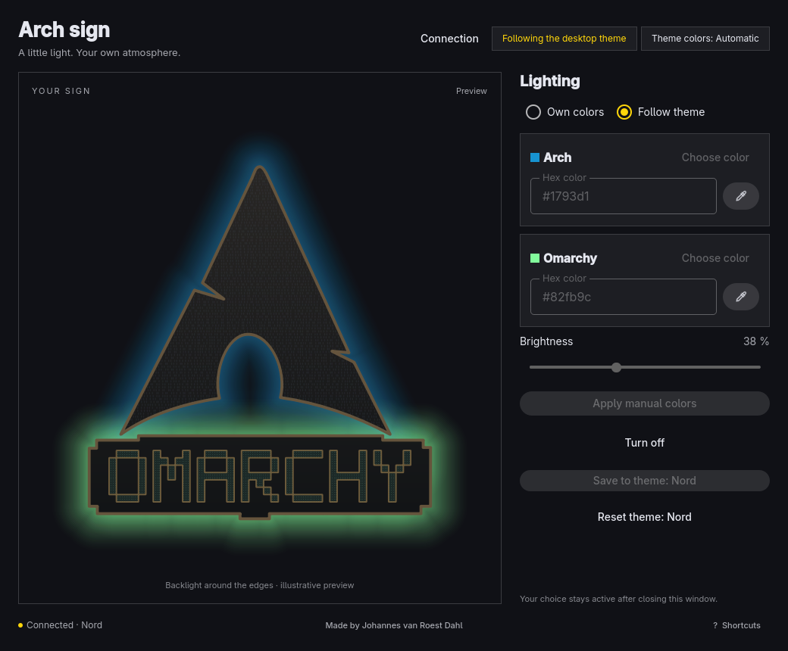

# Arch Sign

A small Qt Quick app for the Arch/Omarchy LED sign. Pick separate Arch and
Omarchy colors, adjust brightness, apply manual colors, follow the desktop
theme again, or switch the sign off.

The sign preview follows the handmade Arch silhouette and pixel Omarchy
wordmark, with a dark textured face and separate colored halos behind the
edges. It follows both draft color choices and brightness. Unapplied changes
are labeled; off mode removes the light. The preview is illustrative rather
than a calibrated simulation of the LEDs and wall.

Run `arch-sign open`, or launch **Arch Sign / Arch-skilt** from Super+Space.
Select **Own colors** to enable the color pickers, or **Follow theme** to
restore automatic mode. The last applied custom colors are remembered when
switching between modes. Colors are applied when you click **Apply manual colors**, normally within two
seconds. Closing the window keeps your selection. Automatic theme colors are
restored with **Follow theme**. No firmware update is needed.

The app writes `~/.local/state/arch-sign/control.json` atomically. The existing
`arch-omarchy-sign.service` reads that choice and sends the usual heartbeats.
It continues to manage the 15-second offline timeout in the firmware. If the
background service is stopped or the ESP32 cannot be reached, the window shows
an error. It never claims a successful save is successful network delivery.
In **Own colors**, the pipette icon beside each hex field starts Hyprpicker.
The app hides while you click a desktop pixel and returns with that color in
the selected logo field. Esc cancels without changing the color. Apply the
colors or save them to the theme afterward. Hyprpicker is a package dependency.

Device settings live in `~/.config/arch-sign/config.json`; the Connection
dialog updates its address. Firmware Wi-Fi credentials remain separate.
If you set `control_directory` in the host configuration, the default GUI path
must be adjusted accordingly; the supplied setup uses the default directory.

The GUI follows Omarchy's full palette, corner rounding and language live.
Background, panels, preview wall, text, borders and Material controls update
from `colors.toml`, including automatic light/dark mode. Missing surface or
secondary text colors are derived from the theme background and foreground. English
and Danish app translations are included. Qt's color dialog lets you select
colors visually, and hex fields accept exact `#rrggbb` colors.

| Shortcut | Action |
|---|---|
| Space / Ctrl+Enter | Apply manual colors |
| Q | Quit (confirm unapplied edits) |
| ? | Show shortcuts |

Click the shortcuts hint in the lower right to open keyboard help.
Click the centered author credit to open https://github.com/dkingger in the
default browser. Both controls also support keyboard focus.

## Build and install

```sh
./bin/build
./bin/test
./bin/install
```

Qt 6 base, declarative and Wayland packages, qmake6, make and GCC are required.
The package installs the binary, desktop entry and icon. The package also installs the Python background service and its dependencies.
On first launch, enter your ESP32 address to enable the service automatically.

## Saved theme colors

Select **Own colors**, choose both colors and brightness, then click
**Save to theme: <name>**. This applies the chosen colors and stores a preset
for the active theme. Switch to **Follow theme** to use that preset whenever
that theme is selected, including after restart.

**Reset theme: <name>** removes only the current theme's preset and switches
back to **Follow theme**, so the background service derives its colors from
the theme files again. Other saved themes and the theme files are preserved.
Presets live in `control.json` under `theme_presets` and survive mode changes.

## Terminal control

```sh
arch-sign status --json
arch-sign manual '#0000ff' '#00ff00' 96 --json
arch-sign theme --json
arch-sign off --json
arch-sign save-theme retro-82 --json
arch-sign reset-theme retro-82 --json
arch-sign skill install --json
```

Manual arguments are Arch color, Omarchy color, then brightness (0–255).
A control command saves the choice; check the status timestamp and result after
the service's next poll to confirm delivery. `status` reports the last result,
which may be stale when the service is stopped. The optional skill installer
writes the bundled instructions to `~/.agents/skills/arch-sign/SKILL.md`.

For screenshot QA without changing desktop settings:
`QT_QUICK_BACKEND=software build/arch-sign preview /tmp/sign.png da`.
This renders a temporary example; it does not send colors to the sign.

## Omarchy bar shortcut

The local plugin in `bar/` places the app icon beside the clock. It opens or
focuses the app using Omarchy's standard launcher helper. Install a copy under
`~/.config/omarchy/plugins/local.arch-sign/`, validate it with
`omarchy plugin validate ~/.config/omarchy/plugins/local.arch-sign`, then run:

```sh
omarchy-shell shell rescanPlugins
omarchy plugin enable local.arch-sign --section centerEnd --index 0
```

It uses the current Omarchy shell rather than Waybar and is remembered across
logins. Disable it with `omarchy plugin disable local.arch-sign`.
